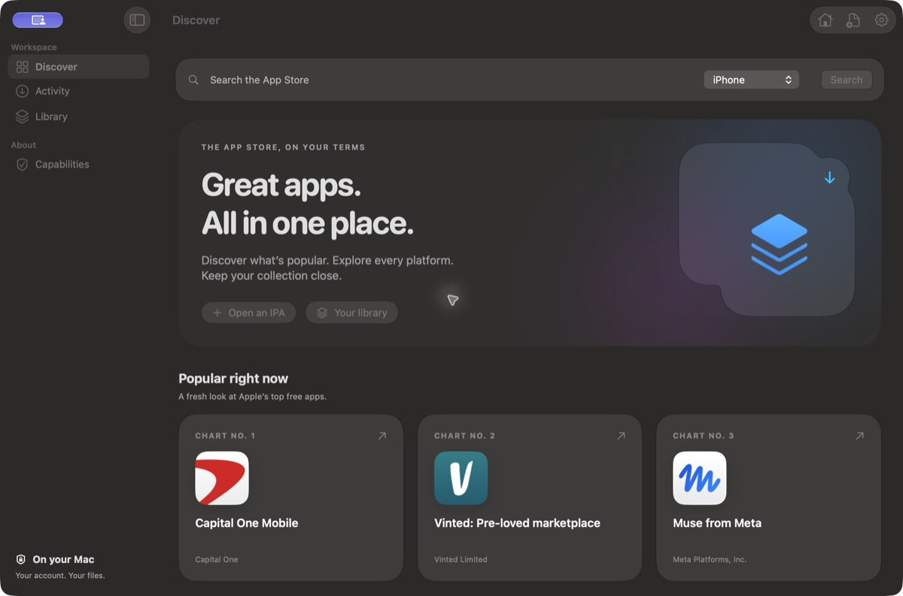
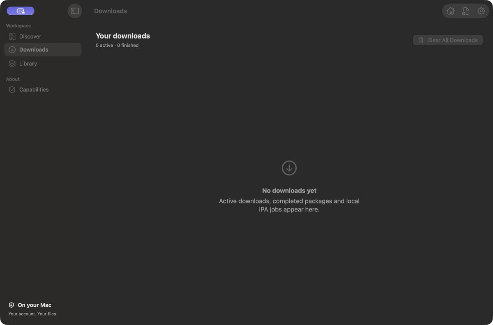
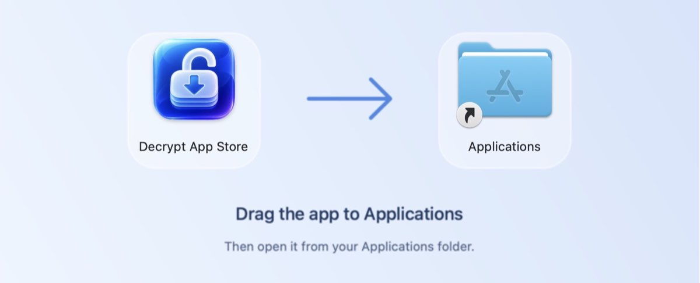

<p align="center">
  
</p>
<h1 align="center">Decrypt App Store</h1>
<p align="center"><strong>Your apps. On your Mac.</strong><br>A native SwiftUI storefront with Liquid Glass and independently validated local IPA decryption.</p>
<p align="center">
  
  
  
</p>
<p align="center"><a href="macos/README.md">Setup & build</a> · <a href="#screenshots">Screenshots</a> · <a href="#support-boundaries">Supported formats</a></p>



## Explore. Download. Inspect.

- **A proper Mac storefront.** Live Apple US top-free charts, real App Store artwork, native sidebars, and Liquid Glass controls.
- **Across Apple platforms.** Search iPhone, iPad, Mac, Apple Watch, Apple Vision and Apple TV listings.
- **Readable version history.** App version numbers by default, with optional external IDs and paged historical lookups.
- **Your decrypted apps.** Library contains only apps successfully decrypted through this app, with icons, versions, builds and Finder reveal. Its catalog stays available when download history is cleared.
- **A dedicated Downloads view.** Active and previous jobs have app icons and version/build details. Clear All Downloads cancels work and clears history while preserving files.
- **A local workflow.** Queue owned downloads or import an IPA, see progress, cancel work, and reveal preserved originals and outputs in Finder.
- **Validation that tells the whole story.** ZIP CRC, app identity, member inventory and every Mach-O slice are checked independently. Unsupported encrypted slices stay visibly marked **Partial**.
- **Private by design.** Existing ipatool Keychain sign-in, a local credential path, argument-array process execution, and no automatic purchases.

## Screenshots

### Downloads



### Drag to install



## Build and run

Requires macOS 26+, Xcode with Swift 6.2+, and Apple Silicon for the currently tested build.

```sh
git clone https://github.com/appleforever11/decrypt-app-store.git
cd decrypt-app-store
./script/build_and_run.sh
```

Configure ipatool, the Python environment, a built fairplay-decrypt checkout, the matching 16-byte credential file, and your output folder in Settings. See the [setup guide](macos/README.md) for the full workflow. No account credentials or downloaded apps are supplied.

```sh
./script/test.sh
```

The automated suites cover process cancellation, concurrent pipe draining, diagnostic privacy, JSON handling, malformed archives and mixed encrypted/clear slices.

## Support boundaries

| Operation | Support |
| --- | --- |
| Search and owned downloads | Six Apple platform selectors; availability depends on Apple and the account |
| Historical downloads | Listed external versions may no longer be downloadable |
| Local IPA decryption | Supported upstream arm64/SINF/SUPF formats |
| Other architectures | Independently audited; may remain encrypted |
| Mac PKG decryption | Not supported; downloaded packages are preserved |
| Installation/runtime compatibility | Not established by static archive validation |

The local DMG is an ad-hoc signed development preview, not a notarized release. It requires the external tools described above. No application binary is published in this repository.

## Credits

The decryption core originates from [EthanArbuckle/fairplay-decrypt](https://github.com/EthanArbuckle/fairplay-decrypt); its original documentation is retained in [docs/UPSTREAM.md](docs/UPSTREAM.md). Downloads and account sessions use [majd/ipatool](https://github.com/majd/ipatool). Charts and catalog artwork are supplied by Apple. This project is independent and is not affiliated with Apple.

The app icon was created with the built-in image-generation tool; the installer artwork and layout are reproducible from the scripts in this repository. See [branding notes](docs/BRANDING.md).
